<div align="center">
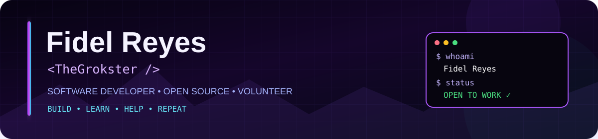
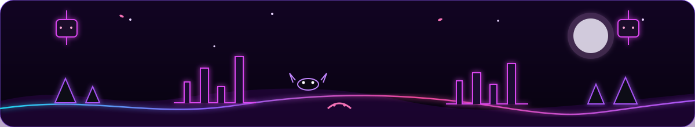
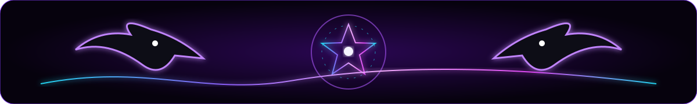

<a href="mailto:fidelreyesramirez000@gmail.com"></a>


<br/><br/>


### `Don't let fear stop you from doing something that could help others.` 💜

</div>

<table><tr><td width="55%" valign="top">

## 💜 `whoami`
```yaml
name: Fidel Reyes
alias: TheGrokster
role: Software Developer
from: Bolivia
status: Open to Work
```
I’m a developer who loves turning ideas into real things — especially through **web development, backend, games, Linux, secure software and learning new tools**.

</td><td width="45%" valign="top">

## ⚡ `currently`
🌐 Building & learning  
🎮 Creating game experiences  
🐧 Linux enthusiast  
🔐 Exploring secure development  
🤖 Curious about AI  
🐶 Dogs + code + good vibes

### 🟢 Available
`Freelance` `Remote` `Part-time` `International`

</td></tr></table>

<div align="center">

### 💜 What I like about software
I enjoy the moment when an idea stops being just an idea and becomes something **real, useful and enjoyable for someone else**.  
I care about writing software that feels thoughtful, learning from every project and improving a little each time.

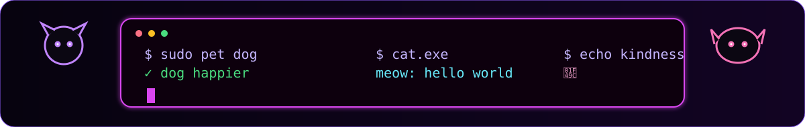

### ✨ How I like to work
**Curiosity first. Ego last.** I like asking questions, experimenting, reading documentation, testing ideas and working with people who enjoy sharing knowledge.

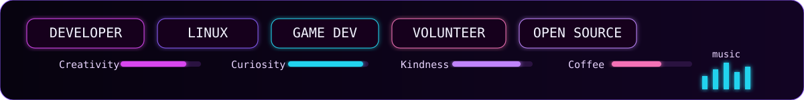

### 🐾 A little personality between the code
I’m serious about my work, but I don’t think a developer profile has to feel cold.  
So yes — there will be **dogs, cats, tiny ghosts, purple neon and probably too many cute things** around here.

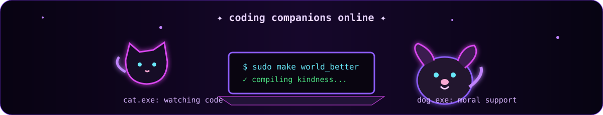
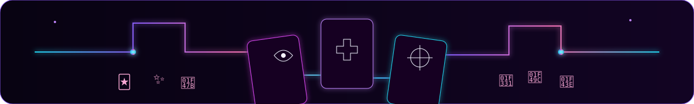
</div>

<div align="center">

## TECHS

I prefer to show the tools I actually enjoy using instead of filling the page with every technology I have ever touched.


<br/><br/>
    

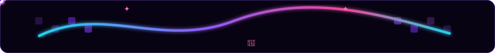

### 🐍 Learning never really ends
My favorite part of technology is that there is always **something new to understand, break, rebuild or improve**. I’m comfortable saying “I don’t know yet” — and then figuring it out.

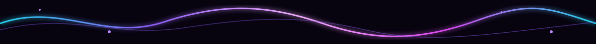
</div>

## 🎮 Something I made
### 🟣 **[Fragmentos Míos — Oozma Kappa](https://fidelreyes.itch.io/fragmentos-mios-oozma-kappa)**
A small game I made with a team for a Game Jam — and it ended up winning. 🏆  
`code × creativity × experimentation × play`

<div align="center">

It was a small project, but I like it because it reminds me that **building something fun with other people can be just as valuable as building something huge**.


</div>

<table><tr><td width="50%" valign="top">

## 💼 `OPEN_TO_WORK.exe`
```diff
+ Freelance
+ Remote
+ Part-time
+ International
+ Collaborations
```
**Interesting idea? Let’s talk.**

I’m especially interested in work where I can **build, learn and contribute meaningfully**, not just complete tickets.

</td><td width="50%" valign="top">

## 💗 `CODE_FOR_GOOD.exe`
🐾 Animal welfare  
🎓 Education  
🌍 NGOs & social initiatives  
🌱 Open Source  
🧑‍💻 Students & beginners

Happy to help voluntarily when I can. 💜

I believe technology becomes more valuable when it can **make someone’s day, work or life a little easier**.

</td></tr></table>

<div align="center">


### 🌱 Why I volunteer
If I have the time and the knowledge can genuinely help, I’m happy to contribute.  
For me, sharing what I know is also a way to keep learning — **with mutual respect on both sides**.
</div>

## 📊 GitHub Signals
<div align="center">

A few numbers from GitHub — useful context, but never the whole story behind a developer.


<br/>


</div>

<div align="center">

### 👾 Beyond programming
A profile should say something about the person too. I like games, series, music, Linux, animals and all the little things that make a project or community feel human.

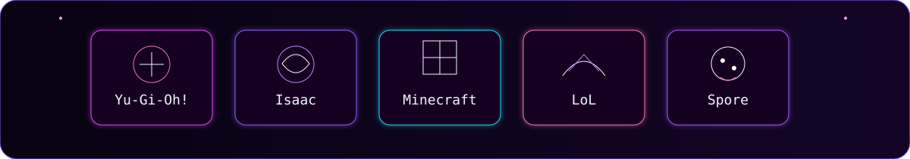
</div>

<table><tr><td width="55%" valign="top">

## 👾 `GEEK_ZONE`
🎴 Yu-Gi-Oh! · 🩸 Isaac · ⛏️ Minecraft  
⚔️ League of Legends · 🧬 Spore  
🧟 The Walking Dead · 💍 LOTR / The Hobbit  
🗡️ Adventure Time · Regular Show

</td><td width="45%" valign="top">

## 🎧 `AFK_MODE`
```text
music      → Slipknot + everything
hobbies    → games · series · volunteering
companions → my dogs + honorary cats
OS         → Fedora / Linux Mint
favorites  → Python / JavaScript
```

</td></tr></table>

<div align="center">


### 🌙 Still here?
Then you already know more about me than a stack of badges ever could.  
If you’re building something interesting, helping a community, or simply want to talk about technology, **my inbox is open**.


## 💌 ✦ TRANSMISSION OPEN ✦
**Job · Freelance · Collaboration · Nonprofit · Tech talk**
<br/><br/>
<a href="mailto:fidelreyesramirez000@gmail.com"></a>
<a href="https://fidelreyes.itch.io/fragmentos-mios-oozma-kappa"></a>
<br/><br/>
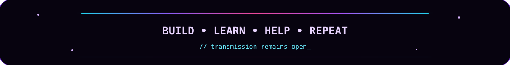

🐦‍⬛ 🌙 🐾 ✨ 💜 **Thanks for visiting my little corner of GitHub.** 💜 ✨ 🐾 🌸 🐶
</div>
